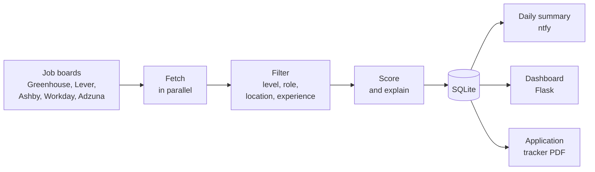

# jobscout

A job and internship finder I built for my own search. Every few hours it reads
the public job boards of 80+ companies, keeps only the postings that fit me, ranks
them, and gives me one place to apply from. Once a day it sends my phone a short
summary of what's new and which applications I need to follow up on.

I'm a sophomore at the University of New Mexico studying statistics and economics,
working toward a sales career at data and AI companies (internships first, then a
sales development role). The filters and scoring are tuned to that path, but all
of it lives in `config.json`.

Built with AI assistance (Claude); I designed it, reviewed and tested the code, and
use it every day.

## What it does
- **Collects postings** from Greenhouse, Lever, Ashby, and Workday job boards, plus
  the Adzuna job search API for local employers without a board of their own.
- **Filters** each posting: student or entry level, a target role, a location I can
  actually get to, and no more than two years of experience required.
- **Scores and explains** every match, for example "business development role,
  internship, mentions SQL", and labels it sales or data so I know which resume to send.
- **Tracks my applications**: what I applied to, when a follow-up is due, and a PDF of
  every application.
- **Cleans up after itself**: closed postings, jobs that stop matching, and jobs I
  never open within a week leave the list.

## How it works


The full walkthrough, module by module, is in [docs/how-it-works.md](docs/how-it-works.md).

## Project layout
```
job_finder.py            command line entry point (scan, daily summary, checks)
dashboard.py             starts the local dashboard
config.json              companies, keywords, weights, and location rules
jobscout/
  sources/               one module per job board, plus parallel fetching
  text.py                whole-word matching, negation, experience parsing
  filters.py             the rules that decide whether a posting fits, and its score
  pipeline.py            one run: fetch, evaluate, record
  storage.py             SQLite: matches, statuses, reach-outs, archive, backups
  notify.py              the daily summary sent through ntfy
  web.py, templates/     the dashboard
  tracker.py             the application tracker PDF
  config.py, models.py   configuration loading and shared data types
tests/                   pytest suite (one file per module)
```

## Running it
```
python3 -m venv .venv && source .venv/bin/activate
pip install -r requirements.txt
cp secrets.example.json secrets.json     # ntfy topic, optional Adzuna keys
cp profile.example.json profile.json     # your application answers
python3 job_finder.py --check            # test every job board
python3 job_finder.py --dry              # full run, prints the summary instead of sending it
python3 dashboard.py                     # opens the dashboard at http://127.0.0.1:5050
```
`python3 job_finder.py --scan` records new postings without sending anything; I run
that every few hours and the full daily run once a day with a scheduler.

## Design decisions
- **Whole-word matching.** Keyword lists match whole words, so "intern" does not match
  "International" and "uk" does not match "Tukwila".
- **Negation and boilerplate.** "No relocation assistance" does not count as offering
  relocation, and "flexible schedule" in a benefits section does not make a job part-time.
- **Explainable scores.** Every score is a sum of named keyword weights, so the
  dashboard can say why a posting ranked where it did.
- **Memory.** Large boards are listed first and descriptions are downloaded only for
  postings that could match; each board is evaluated as soon as it arrives. This
  cut peak memory roughly in half.
- **Correct cleanup.** A posting is marked closed only when it disappears from a board
  that lists everything; search-based sources (Workday, Adzuna) never close postings
  just because a search did not return them.
- **Data stays private.** Keys and the ntfy topic live in `secrets.json`, personal
  answers in `profile.json`; both are git-ignored.

## Tests and code quality
```
pip install -r requirements-dev.txt
python3 -m pytest              # 220+ tests, no network needed
python3 -m ruff check .        # lint
python3 -m mypy                # strict type checking
```
The same checks run on GitHub Actions for every push.
