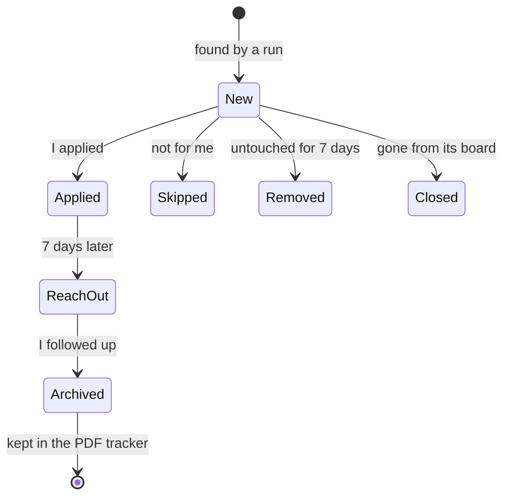

# How jobscout works

This walks through one run from start to finish, in the order the code runs it.
Each section names the module to read alongside it.

## 1. Configuration (`config.py`, `config.json`)
Everything that reflects my goals is data, not code: the companies to check, the
keywords for levels and roles, the scoring weights, and the location rules.
`load_config` validates every key and fails with a clear message (for example
"'daily_alert_time' must be a 24-hour time such as "14:05"") so a typo can't
silently change which jobs match. API keys and the notification topic come from
`secrets.json` or environment variables, never from `config.json`.

## 2. Fetching (`sources/`)
Each job board type has a small module with a `fetch(company, options)` function
that returns a list of `Job` objects (`models.py`).

| Board | How it's read |
| --- | --- |
| Greenhouse | List every posting, then download descriptions only for titles that could match |
| Lever, Ashby | One request returns every posting with its description |
| Workday | Keyword search (it has no "list everything" endpoint), then download matching postings |
| Adzuna | Job search API, limited to Albuquerque, run once a day to stay inside its free quota |

`map_fetch` in `sources/__init__.py` fetches companies in parallel with a thread
pool. Each worker evaluates its own board right away and keeps only the short
details, so only a few boards are ever in memory at once. One broken board is
reported and skipped; it never stops the run. `http.py` retries network errors
and server errors with exponential backoff, but fails fast on errors like 404 that
retrying won't fix.

## 3. Filtering (`filters.py`, `text.py`)
`JobFilter.evaluate` applies the rules in order and stops at the first one that fails,
returning an `Evaluation` with the reason in plain words:

1. **Title.** Reject senior, graduate-only, and engineering titles, and titles that
   only name past years ("Summer 2026" once it is 2027).
2. **Level.** Require a student or beginner signal (internship, part-time, entry
   level, "no experience required", and so on) in the title, the start of the
   description, or the board's own employment type.
3. **Role.** Require a target role in the title, such as sales, business development,
   analytics, or economics.
4. **Location.** I'm a full-time student without a car:

   | Where | Internship | Other jobs |
   | --- | --- | --- |
   | Outside the US | No | No |
   | Albuquerque | Yes | Yes |
   | Remote or not listed | Yes | Only if part-time |
   | Elsewhere in the US | Only with housing, relocation, or a stipend | No |

   Internships that fail only the housing check are kept as "near misses" for me to
   review rather than thrown away.
5. **Experience.** Reject postings asking for more than two years.

`text.py` holds the matching helpers: `term_pattern` builds a whole-word regular
expression from a keyword list, `find_unnegated` skips phrases like "no relocation",
and `years_required` only counts numbers followed by the word "experience".

## 4. Scoring
A passing posting's score is the sum of three parts:
- keywords anywhere in the title or description (`score_keywords`), including
  negative weights such as "rising senior" or "100% commission";
- keywords in the title (`title_score_keywords`), where sales titles weigh most;
- a bonus for internships and for part-time jobs.

Each contributing keyword is saved as a reason, which the dashboard turns into a
sentence and a label such as "Great fit" or "Worth a look".

## 5. Storage and the life of a posting (`storage.py`)
`JobStore.sync` records a run: new matches are inserted, existing ones re-scored,
edited postings updated, and postings that stop matching are flagged with the reason.

The `jobs` table keeps a fixed set of columns; everything added later (match
details, apply dates, notes, the archive) lives in side tables keyed by job id.
Removed and archived postings stay remembered, so a later run doesn't add them back.
The daily run also writes a backup of the database and keeps the last 14.

## 6. The daily summary (`notify.py`, `cli.py`)
`run_daily` runs the pipeline, then builds one message: how many jobs are waiting,
every reach-out that's due (repeated daily until I follow up), what's coming up this
week, new matches, and any broken job boards. It's sent through ntfy as JSON and kept
under ntfy's 4 KB limit. If the run crashes, a separate "Job finder failed" alert is
sent instead, so a failure never goes unnoticed.

## 7. The dashboard and tracker (`web.py`, `templates/`, `tracker.py`)
A small Flask app lists every posting with tabs (New, Check housing, Reach out,
Applied, Skipped, Closed, All). "Apply" records that I opened the posting and then
redirects to it; until I mark it, the card asks whether I applied. Every form
carries a per-process token, so other websites can't change my data. The "My
answers" page has copy buttons for the questions every application asks, and
`tracker.py` renders the application history as a PDF with fpdf2.

## 8. Testing
Each module has a test file in `tests/`. Network calls are replaced with fake
responses, the database runs in memory, and time is passed in explicitly, so the
whole suite runs in under a second without internet access. CI runs ruff, strict
mypy, and pytest on Python 3.12 and 3.13.
